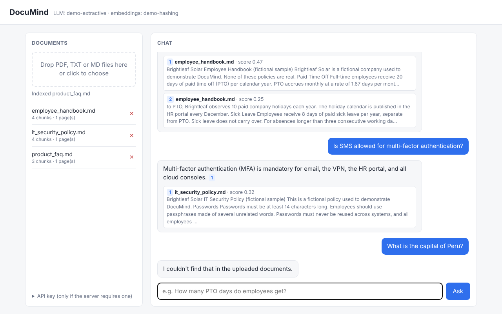
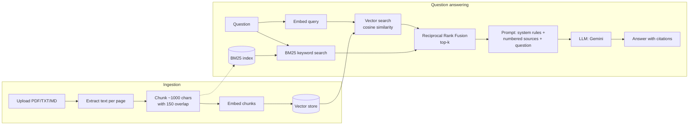

# DocuMind

**Ask questions about your documents and get answers that cite their sources.**

DocuMind is a Retrieval-Augmented Generation (RAG) service built with **FastAPI**, **Pydantic** and **Google Gemini**. Upload PDFs, text or Markdown files, ask questions in plain English, and get grounded answers with numbered citations that point to the exact file and page.



## Features

- **Upload PDF, TXT and Markdown** with page-aware citations ("handbook.pdf · page 3")
- **Hybrid search**: semantic vector search + BM25 keyword search (written from scratch), merged with Reciprocal Rank Fusion, so both paraphrased questions and exact terms (product names, codes, emails) find the right passage
- **Cited answers** like `[1]`, plus a refusal ("I couldn't find that…") when the documents don't contain the answer, instead of a hallucinated one
- **Streaming responses** (NDJSON): sources arrive first, then the answer token by token
- **Runs offline in demo mode** with no API key, so anyone can clone and try it in 30 seconds
- **Pluggable providers**: the pipeline depends on small `Embedder`/`LLM` interfaces, not on a vendor SDK
- **Production touches**: retries with exponential backoff, duplicate-upload detection, upload size limits, optional API-key auth, request logging, Docker, CI
- **Retrieval evaluation**: a labeled question set measuring Hit@k and MRR per question type, comparing vector, BM25 and hybrid retrieval side by side, run in CI
- **Prompt-injection hardening**: document text is wrapped in XML tags and treated as untrusted data

## Architecture



| Layer | File | Responsibility |
|---|---|---|
| API | `app/main.py` | Routes, validation, auth, streaming, error mapping |
| Pipeline | `app/rag.py` | Ingest, hybrid retrieval + rank fusion, build prompt, generate |
| Keyword search | `app/bm25.py` | BM25 ranking with an inverted index, rebuilt when documents change |
| Ingestion | `app/ingestion/` | PDF/text extraction, boundary-aware chunking |
| Providers | `app/providers/` | `gemini.py` (real), `demo.py` (offline), `base.py` (interfaces) |
| Storage | `app/vectorstore.py` | NumPy vector index, persisted to disk, thread-safe |
| Config | `app/config.py` | Typed settings from env vars / `.env` |

## Quick start

**Requirements:** Python 3.11+

```bash
git clone https://github.com/<your-username>/documind.git
cd documind
python -m venv .venv
source .venv/bin/activate          # Windows: .venv\Scripts\activate
pip install -r requirements-dev.txt

uvicorn app.main:create_app --factory --reload
```

Open **http://localhost:8000**, drop the files from `sample_docs/` into the page, and ask *"How many PTO days do full-time employees get?"*

Interactive API docs are at **http://localhost:8000/docs**.

### Use real AI (Gemini)

1. Get a free API key at <https://aistudio.google.com/apikey>.
2. Create your config: `cp .env.example .env`
3. Edit `.env`:
   ```
   PROVIDER=gemini
   GEMINI_API_KEY=your-key-here
   ```
4. Restart the server. The header shows which models are active.

Model names are settings (`GEMINI_CHAT_MODEL`, `GEMINI_EMBEDDING_MODEL`), so you can switch to newer models without code changes.

### Run with Docker

```bash
docker compose up --build
```

Indexed documents are stored in `./data` and survive restarts.

## API

| Method | Path | Description |
|---|---|---|
| `POST` | `/documents` | Upload and index a file (201 new, 200 if identical content already indexed) |
| `GET` | `/documents` | List indexed documents |
| `DELETE` | `/documents/{doc_id}` | Remove a document and its vectors |
| `POST` | `/ask` | Ask a question; returns answer + citations |
| `POST` | `/ask/stream` | Same, streamed as newline-delimited JSON |
| `GET` | `/health` | Status, active models, document count |

```bash
curl -F "file=@sample_docs/employee_handbook.md" http://localhost:8000/documents

curl -X POST http://localhost:8000/ask \
  -H "Content-Type: application/json" \
  -d '{"question": "How many PTO days can I carry over?", "top_k": 4}'
```

```json
{
  "answer": "Up to 5 unused PTO days can be carried over, and they must be used by March 31 [1].",
  "citations": [
    {"source": 1, "filename": "employee_handbook.md", "page": null, "score": 0.71, "snippet": "..."}
  ],
  "grounded": true
}
```

`/ask` also accepts `"retrieval_mode": "vector" | "bm25" | "hybrid"` to override the server default (`RETRIEVAL_MODE`, default `hybrid`).

Set `API_KEY` in `.env` to require an `X-API-Key` header on every endpoint except `/health`.

## Testing and evaluation

```bash
pytest -q                       # unit + API tests (fully offline)
ruff check .                    # lint
python -m evals.run_eval        # retrieval quality, demo embeddings
python -m evals.run_eval --mode all                   # compare vector vs BM25 vs hybrid
python -m evals.run_eval --provider gemini --answers   # with real models
```

The eval script indexes `sample_docs/`, runs the questions in `evals/eval_set.json`, and reports:

- **Hit@k**: how often the right document appears in the top-k results
- **MRR**: how high it ranks (1.0 = always first)

Questions are tagged `semantic` (paraphrased, e.g. "vacation days" for PTO) or `exact_term` (names, codes, emails such as "YubiKeys" or "security@brightleaf.example"), and results are reported for each. Offline demo-mode results on the 20-question set:

| Mode | Hit@4 | MRR | semantic MRR | exact-term MRR |
|---|---|---|---|---|
| vector | 100% | 0.975 | 1.000 | 0.917 |
| bm25 | 90% | 0.900 | 0.857 | 1.000 |
| **hybrid** | **100%** | **1.000** | **1.000** | **1.000** |

Each method misses where the other is strong; fusing them fixes both. The demo embedder is itself keyword-based, so run `--provider gemini --mode all` to measure the gap with real embeddings.

Use it to tune `CHUNK_SIZE`, `CHUNK_OVERLAP`, `top_k` and `MIN_SCORE` with numbers instead of guesses. CI fails if Hit@4 drops below 90%.

## Design decisions

- **Demo mode.** Hash-based embeddings and an extractive "LLM" let the project run with no key, keep tests fast and deterministic, and show that the pipeline is provider-agnostic. Demo answers are keyword-based; Gemini mode is where answer quality comes from.
- **NumPy instead of a vector database.** Exact cosine search over a matrix is simple, transparent and fast enough for tens of thousands of chunks. The `VectorStore` class is the seam for swapping in pgvector, Qdrant or Chroma at scale.
- **Skip the LLM when nothing relevant is found.** If no chunk passes `MIN_SCORE`, the API answers "not found" without calling the model: cheaper, faster and no chance to hallucinate.
- **Hybrid search with Reciprocal Rank Fusion.** Embeddings capture meaning but blur rare exact tokens; BM25 is the opposite. RRF merges the two ranked lists using only ranks (`1 / (60 + rank)`), so a cosine score and a BM25 score never have to be put on the same scale. BM25 is implemented from scratch with an inverted index and rebuilt lazily when the store's version changes. Keyword hits must cover at least half the question's keywords (`BM25_MIN_COVERAGE`), so one common word can't pull in an unrelated chunk and break the "not found" answer.
- **Boundary-aware chunking.** Chunks break at paragraphs, then sentences, with overlap so facts spanning a boundary aren't lost.
- **Separate index per embedding model.** Vectors from different models are not comparable, so each model gets its own folder under `data/`.
- **Blocking work off the event loop.** Upload parsing and embedding run in a thread pool (`run_in_threadpool`); LLM endpoints are plain `def` so FastAPI threads them automatically.

## Roadmap

- [x] Hybrid search (BM25 + vectors with Reciprocal Rank Fusion)
- [ ] Cross-encoder re-ranker
- [ ] Conversation memory for follow-up questions
- [ ] pgvector backend for larger corpora
- [ ] OCR for scanned PDFs
- [ ] Per-user document collections and JWT auth
- [ ] LLM-as-judge answer evaluation (faithfulness, relevance)

## Project structure

```
documind/
├── app/
│   ├── main.py            # FastAPI app factory and routes
│   ├── rag.py             # RAG pipeline + rank fusion
│   ├── bm25.py            # BM25 keyword index
│   ├── text.py            # Tokenizer shared by BM25 and demo mode
│   ├── config.py          # Settings (pydantic-settings)
│   ├── factory.py         # Builds providers from settings
│   ├── schemas.py         # Pydantic models
│   ├── vectorstore.py     # NumPy vector store
│   ├── ingestion/         # Loaders and chunker
│   ├── providers/         # Gemini, demo, interfaces
│   └── static/index.html  # Web UI
├── evals/                 # Retrieval evaluation
├── sample_docs/           # Fictional demo documents
├── tests/                 # pytest suite
├── Dockerfile, docker-compose.yml
└── .github/workflows/ci.yml
```

## License

MIT
